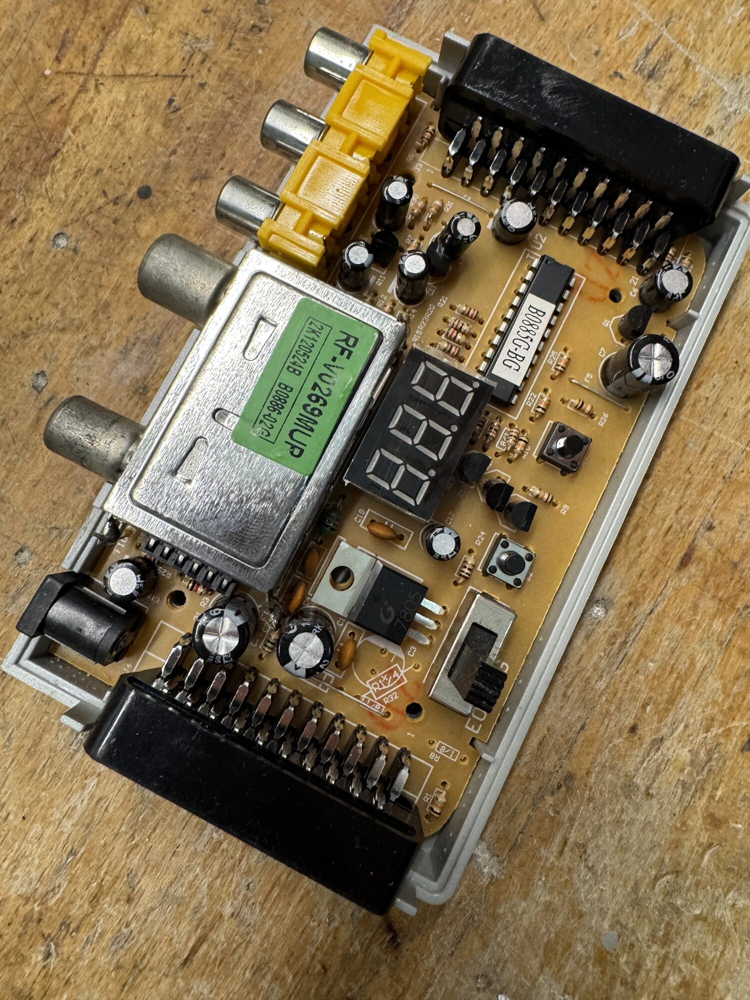
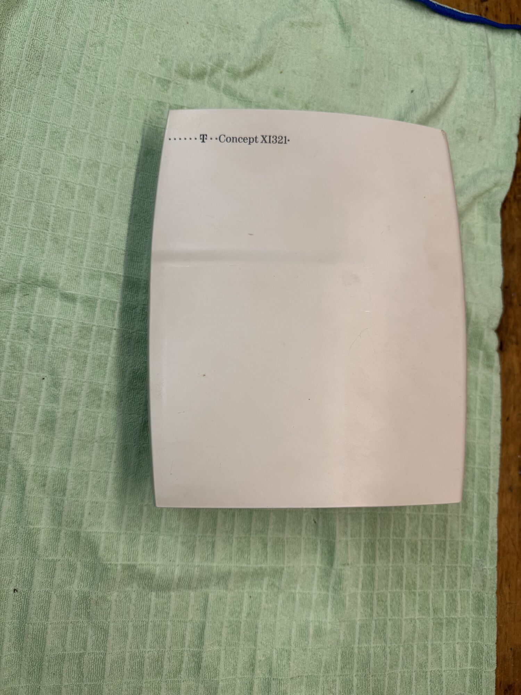
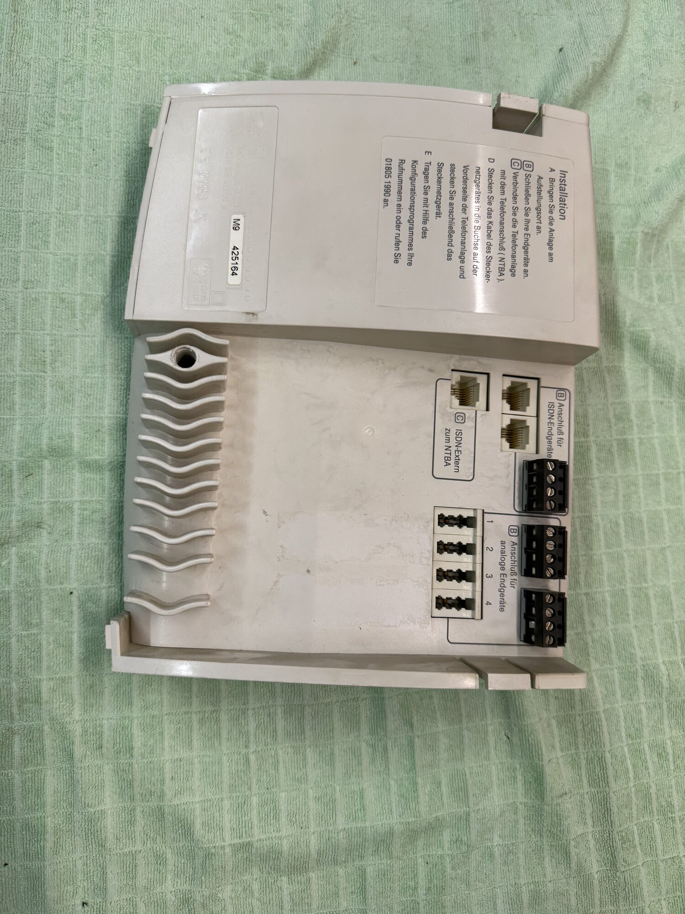
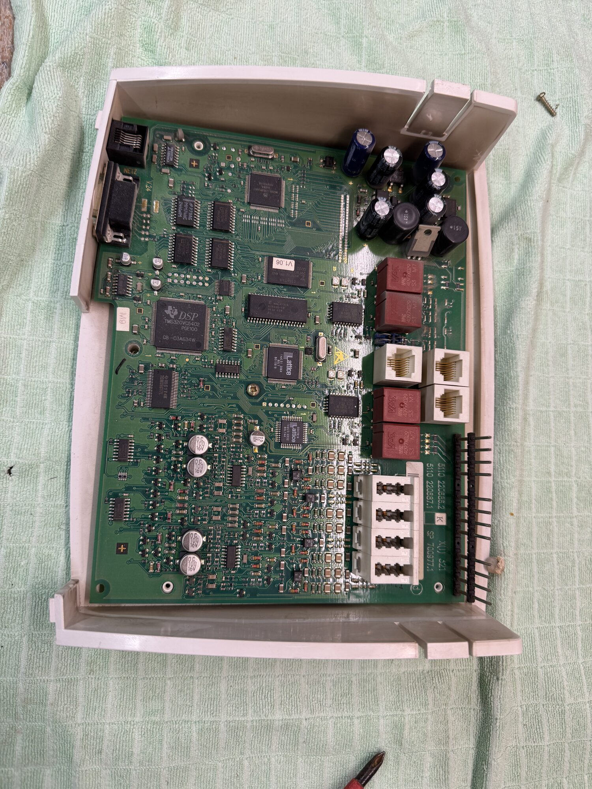
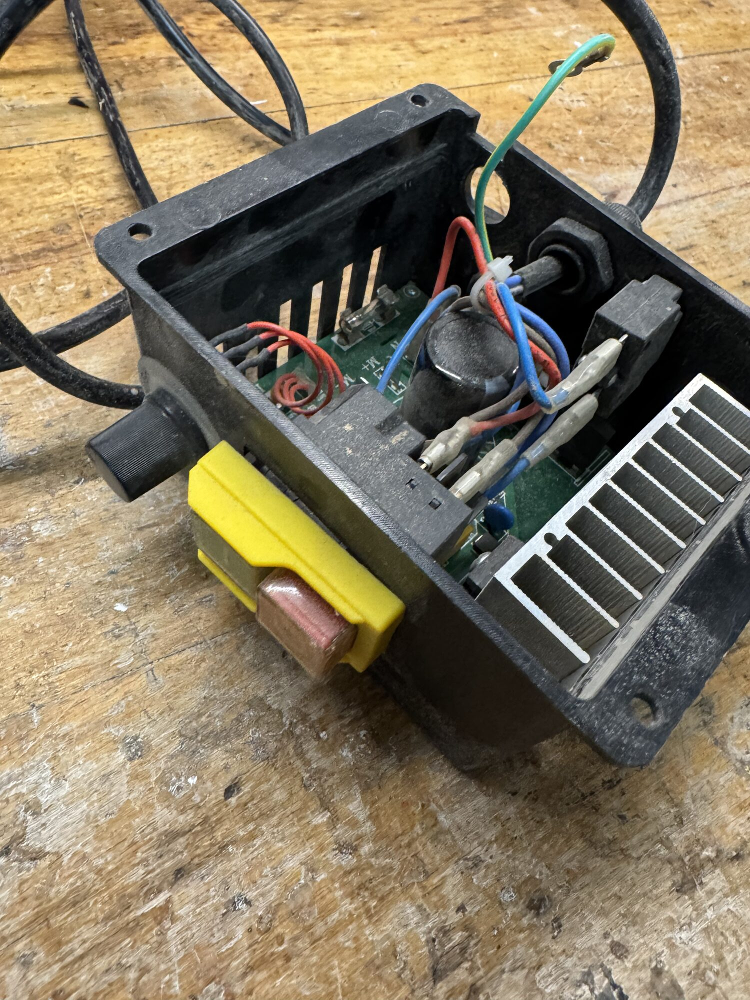
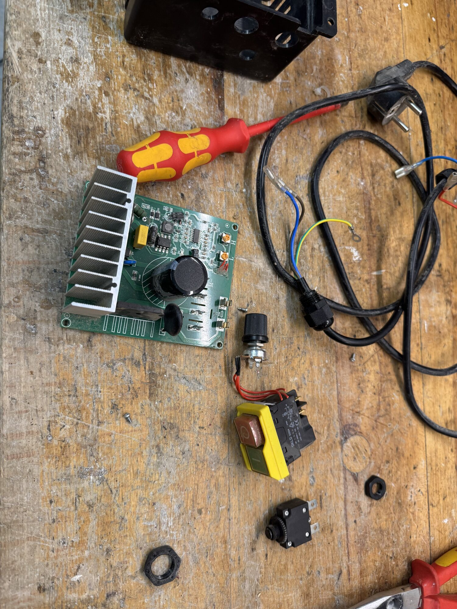

Mehrere alte defekte Geräte waren endültig zu entsorgen.

1. Kabelsignalwandler
 

2. Alte Telefonanlage
 
 
 

3. Motorsteurung einer Drehbank
 
 

Da wollte Papa den Schalter aufheben.

Ich habe den Rest der Platinen dann kaputt gemacht, das hat mir Spaß gemacht.